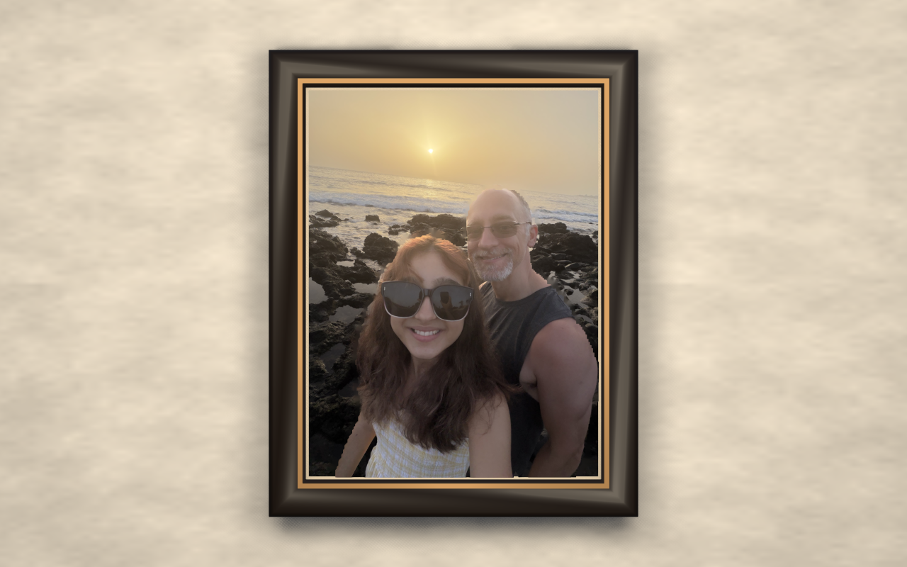

[](https://twitter.com/deanthecoder) [](https://github.com/deanthecoder/HoloFrame/stargazers)

# HoloFrame

**Turn your screen into a window into a 3D world.**

HoloFrame uses your webcam to follow your head and adjust the view through your screen. Lean left to look around the teapot, move closer to see more of the room, or look down to reveal its upper surfaces. The scene stays in place while your viewpoint moves—no headset or special glasses required.


Captured in-app with a live webcam reflection on a 14-inch MacBook Pro with the display calibration applied.

## Features

- **A window that follows your viewpoint.** Perspective changes with your eye position, keeping the screen's edges fixed as you move.
- **A room with depth.** A floating teapot, two blocks, and a distant sphere give you objects to look around and compare.
- **Soft lighting and shadows.** Baked indirect lighting, live shadows, ambient occlusion, and subtle color bounce give the room its shape.
- **A glimpse of your surroundings.** The webcam adds blurred reflections to the scene's materials, alongside reflections of the virtual room.
- **Smooth movement.** Filtered head tracking steadies the view and holds the last position when your face briefly disappears.
- **Remembered setup.** Center the view with a keypress; HoloFrame remembers your seating adjustment and successful camera choice.

## Quick start

### Windows (PowerShell)

You'll need a webcam, [Python 3.12](https://www.python.org/downloads/windows/), and [Godot 4.7](https://godotengine.org/download/windows/) (the standard build; .NET is not required). Extract Godot and note the path to its `.exe`. The scene uses Godot's Forward+ renderer.

Clone the project and install the gallery dependencies:

```powershell
git clone https://github.com/deanthecoder/HoloFrame.git
cd HoloFrame
py -3.12 -m venv .venv
.\.venv\Scripts\python.exe -m pip install -r requirements-photo.txt
$env:GODOT_EXE = "C:\Tools\Godot\Godot_v4.7.2-stable_win64.exe"
.\run_gallery.cmd
```

Replace the example Godot path with your extracted executable. `GODOT_EXE` applies to the current PowerShell session; set it again in a new terminal, or pass `--godot "C:\path\to\Godot.exe"` to the launcher. Godot named `godot` or `godot4` on `PATH` is also detected. No virtual environment activation or execution-policy change is needed.

To open your own photo or the Cornell box:

```powershell
.\run_gallery.cmd --photo "C:\Users\Dean\Pictures\photo.jpg"
.\run_cornell.cmd
```

These `.cmd` shortcuts work in PowerShell and Command Prompt, use the project's virtual environment, and forward extra options to `run_godot.py`. You can also use `.\run_godot.cmd` directly (Cornell by default).

For just the Cornell box, installing `requirements.txt` is sufficient. The gallery downloads its depth model on first use, so allow extra time and an internet connection for that first launch.

### macOS

Tested on a **14-inch MacBook Pro (2021, M1 Pro)**. Install Python 3.12 and [Godot 4.7](https://godotengine.org/download/macos/) as `/Applications/Godot.app`.

Clone the project and install its Python dependencies:

```sh
git clone https://github.com/deanthecoder/HoloFrame.git
cd HoloFrame
python3.12 -m venv .venv
.venv/bin/python -m pip install -r requirements.txt
```

Then launch the Cornell box:

```sh
./run_cornell.sh
```

To open the photo gallery, install the optional depth model dependencies and run:

```sh
.venv/bin/python -m pip install -r requirements-photo.txt
./run_gallery.sh
```

These shortcuts pass extra options through to `run_godot.sh`. For example, `./run_gallery.sh --photo /path/to/photo.jpg` opens a local image, and `./run_cornell.sh --reset-camera` rescans webcams. You can still use `./run_godot.sh` directly.

### Using the gallery

The first run downloads Depth Anything V2 Small, estimates relative depth, and saves a depth map plus foreground and approximate background layers in the ignored `.holoframe-photos/` folder. The photo is processed locally and stays at its original path. The gallery scene places it in a dark frame on a lightly textured white wall with two lights and a soft shadow. Its wall is at the screen plane and the frame projects slightly toward you. Move your head gently to see the parallax. Since one photo contains no view behind its subject, uncovered areas are filled approximately and can look rough with large movements. The Cornell room also launches with `./run_godot.sh` or `./run_godot.sh --cornell`.

Pass up to three `--photo PATH` pairs to switch between photos with **1**, **2**, and **3**. If you have local files named `.holoframe-photos/photo-1.jpg` through `photo-3.jpg`, `.\run_gallery.cmd` (or `./run_gallery.sh` on macOS) opens that set. Those local source photos and all generated layers are ignored by Git.

The repository includes one sample, [photo 3](photos/photo-3.jpg). On a fresh clone, the gallery launcher opens it. The full three-photo local set takes precedence when present; photos 1 and 2 and all generated layers stay outside Git.



The launcher starts both the app and its webcam tracker. Allow camera access if prompted, sit where you normally use your screen, and give it a moment to find your face. Press **C** to center the view, then move your head gently to explore.

## Controls

| Key | Action |
| --- | --- |
| **C** | Center the view for your current seating position and save the adjustment. |
| **Shift+C** | Clear the saved seating adjustment. |
| **S** | Save a screenshot of the current view to Downloads. |
| **1**, **2**, **3** | Switch photos when running a photo gallery. |
| **Escape** | Quit the app and stop the webcam tracker. |

Recalibrate after moving your screen or webcam. The seating adjustment changes horizontal and vertical alignment; distance and head movement remain tracked.

## Match your display

HoloFrame needs your screen's physical size to make it behave like a window. The included [display profile](godot/display_profile.json) is set up for the 14-inch 2021 MacBook Pro running fullscreen below its notch:

| Setting | Value |
| --- | --- |
| Active view width | 302.4 mm |
| Active view height | 189.8 mm |
| Webcam center above the active view | Approximately 3.3 mm |

For another display, update the profile with the dimensions of the area used by the app and the webcam's height above it. Run fullscreen for the intended perspective. The webcam position and face size are estimates, so calibration is approximate; see the [rendering and calibration notes](godot/README.md) for details.

## Camera setup

On first setup, HoloFrame scans connected webcams until one detects your face, then saves that device. Temporary face loss keeps the same webcam selected, including during that first session. Later launches use only the saved webcam. If it is disconnected or you want to scan again, run:

```powershell
.\run_gallery.cmd --reset-camera
```

The reset clears the saved choice and scans for a new one. It also works with `--gallery` or `--photo`.

To choose a camera explicitly, pass its index:

```powershell
.\run_gallery.cmd --camera-index 1
```

These options work with either scene. On macOS, use `./run_gallery.sh --reset-camera` or `./run_gallery.sh --camera-index 1`.

Keep your face well lit and close other apps using the camera if tracking doesn't start. On Windows, enable camera access for desktop apps in **Settings → Privacy & security → Camera**. On macOS, check **System Settings → Privacy & Security → Camera**.

Webcam frames stay on your computer. The tracker sends head position and a small, blurred image to the renderer over localhost; webcam images are neither saved nor uploaded.

## How it works

[MediaPipe](https://ai.google.dev/edge/mediapipe/solutions/vision/face_landmarker) and [OpenCV](https://opencv.org/) estimate the midpoint between your eyes. [Godot](https://godotengine.org/) uses that position to render a fixed scene through the physical corners of your screen. Python handles the webcam automatically while Godot handles the scene, lighting, and reflections.

The effect is designed for one viewer and uses a single image for both eyes. Webcam reflections approximate the visible surroundings; they aren't a complete capture of your room. Screen size, camera placement, and tracking accuracy all affect how convincing the window feels.

<details>
<summary><strong>Working on the scene</strong></summary>

Open [godot/project.godot](godot/project.godot) in the Godot editor to edit the room. The saved lighting bake is included. After changing the room or lighting, select its LightmapGI node, click **Bake Lightmaps**, and save the scene.

Run the Python checks from the repository root:

```powershell
.\.venv\Scripts\python.exe -m unittest -v
```

Check the view, calibration, reflection inputs, and shadow settings:

```powershell
& $env:GODOT_EXE --path godot --script res://tests/check_view.gd
```

Check the in-game screenshot key with a rendered frame:

```powershell
& $env:GODOT_EXE --path godot --script res://tests/check_screenshot.gd
```

On macOS, substitute `.venv/bin/python` and `/Applications/Godot.app/Contents/MacOS/Godot` for the executables above. See the [rendering notes](godot/README.md) for lighting settings and screenshot capture commands.

</details>

## License

HoloFrame's source code is available under the [MIT License](LICENSE). The scene uses the [Utah Teapot](https://graphics.cs.utah.edu/teapot/) model; its [attribution and terms](godot/models/TEAPOT_ATTRIBUTION.txt) are documented separately.
