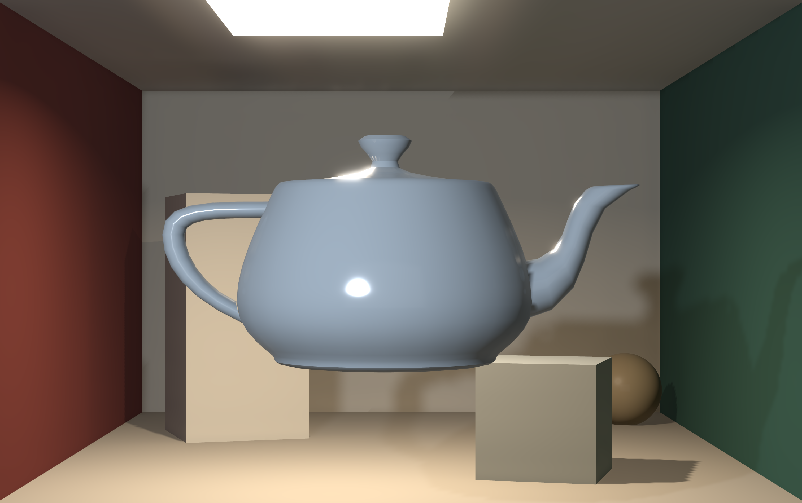

[](https://twitter.com/deanthecoder) [](https://github.com/deanthecoder/HoloFrame/stargazers)

# HoloFrame

**Turn your screen into a window into a 3D world.**

HoloFrame uses your webcam to follow your head and adjust the view through your screen. Lean left to look around the teapot, move closer to see more of the room, or look down to reveal its upper surfaces. The scene stays in place while your viewpoint moves—no headset or special glasses required.



Captured on a 14-inch MacBook Pro with the display calibration applied.

## Features

- **A window that follows your viewpoint.** Perspective changes with your eye position, keeping the screen's edges fixed as you move.
- **A room with depth.** A floating teapot, two blocks, and a distant sphere give you objects to look around and compare.
- **Soft lighting and shadows.** Baked indirect lighting, live shadows, ambient occlusion, and subtle color bounce give the room its shape.
- **A glimpse of your surroundings.** The webcam adds blurred reflections to the scene's materials, alongside reflections of the virtual room.
- **Smooth movement.** Filtered head tracking steadies the view and holds the last position when your face briefly disappears.
- **Remembered setup.** Center the view with a keypress; HoloFrame remembers your seating adjustment and successful camera choice.

## Quick start

The current launcher is for **macOS**, tested on a **14-inch MacBook Pro (2021, M1 Pro)**. You'll need a webcam, [Python 3.12](https://www.python.org/downloads/), and [Godot 4.7](https://godotengine.org/download/macos/) installed as `/Applications/Godot.app`. The scene uses Godot's Forward+ renderer.

Clone the project and install its Python dependencies:

```sh
git clone https://github.com/deanthecoder/HoloFrame.git
cd HoloFrame
python3.12 -m venv .venv
.venv/bin/python -m pip install -r requirements.txt
```

Then launch HoloFrame:

```sh
./run_godot.sh
```

The launcher starts both the app and its webcam tracker. Allow camera access if macOS asks, sit where you normally use your screen, and give it a moment to find your face. Press **C** to center the view on the teapot, then move your head gently to explore.

## Controls

| Key | Action |
| --- | --- |
| **C** | Center the view for your current seating position and save the adjustment. |
| **Shift+C** | Clear the saved seating adjustment. |
| **Escape** | Quit the app and stop the webcam tracker. |

Recalibrate after moving your screen or webcam. The seating adjustment changes horizontal and vertical alignment; distance and head movement remain tracked.

## Match your display

HoloFrame needs your screen's physical size to make it behave like a window. The included [display profile](godot/display_profile.json) is set up for the 14-inch 2021 MacBook Pro running fullscreen below its notch:

| Setting | Value |
| --- | --- |
| Active view width | 302.4 mm |
| Active view height | 189.8 mm |
| Webcam center above the active view | Approximately 3.3 mm |

For another display, update the profile with the dimensions of the area used by the app and the webcam's height above it. Run fullscreen for the intended perspective. The webcam position and face size are estimates, so calibration is approximate; see the [rendering and calibration notes](godot/README.md) for details.

## Camera setup

HoloFrame tries the last successful webcam first. If several cameras are available and it doesn't find a face after a second, it tries another. This also helps when an iPhone appears as a Continuity Camera alongside the Mac's built-in camera.

To choose a camera explicitly, pass its index:

```sh
./run_godot.sh 1
```

Keep your face well lit and close other apps using the camera if tracking doesn't start. On macOS, check camera access in **System Settings → Privacy & Security → Camera**.

Webcam frames stay on your computer. The tracker sends head position and a small, blurred image to the renderer over localhost; webcam images are neither saved nor uploaded.

## How it works

[MediaPipe](https://ai.google.dev/edge/mediapipe/solutions/vision/face_landmarker) and [OpenCV](https://opencv.org/) estimate the midpoint between your eyes. [Godot](https://godotengine.org/) uses that position to render a fixed scene through the physical corners of your screen. Python handles the webcam automatically while Godot handles the scene, lighting, and reflections.

The effect is designed for one viewer and uses a single image for both eyes. Webcam reflections approximate the visible surroundings; they aren't a complete capture of your room. Screen size, camera placement, and tracking accuracy all affect how convincing the window feels.

<details>
<summary><strong>Working on the scene</strong></summary>

Open [godot/project.godot](godot/project.godot) in the Godot editor to edit the room. The saved lighting bake is included. After changing the room or lighting, select its LightmapGI node, click **Bake Lightmaps**, and save the scene.

Run the Python checks from the repository root:

```sh
.venv/bin/python -m unittest -v
```

Check the view, calibration, reflection inputs, and shadow settings:

```sh
/Applications/Godot.app/Contents/MacOS/Godot --path godot --script res://tests/check_view.gd
```

See the [rendering notes](godot/README.md) for lighting settings and screenshot capture commands.

</details>

## License

HoloFrame's source code is available under the [MIT License](LICENSE). The teapot asset is distributed under its own [BSD license](godot/models/TEAPOT_LICENSE.txt).
