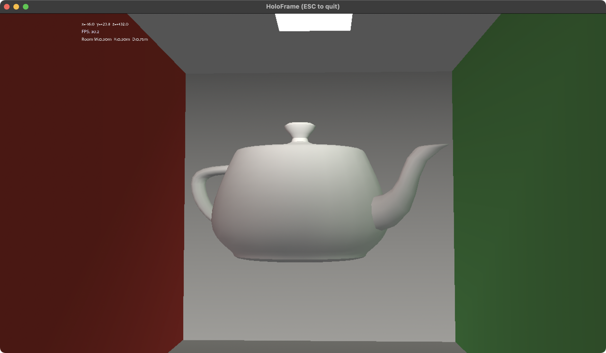

[](https://twitter.com/deanthecoder)

# HoloFrame
HoloFrame is a Panda3D experiment that renders a head-tracked scene based on live webcam input.

## Features
- Real-time head pose tracking via MediaPipe FaceMesh and solvePnPRansac.
- One Euro filter smoothing for stable camera motion.
- Off-axis perspective through a fixed screen aperture, with a stationary 3D scene.
- Borderless Windows viewer that prefers the active built-in laptop display.
- Adjustable room dimensions and lighting.
- Glazed ceramic highlights, a shadow-casting front light, and 50 mm floor/back-wall
  seams provide depth cues as the viewer or model moves.
- A tall rotated block, a shorter block, and a distant sphere provide fixed depth
  references in a warm Cornell-style room. They stay on the floor as room dimensions
  change; the model depth controls still move only the foreground model.
- On-screen status for pose, frame timing, and virtual room size.
- Modular utilities for pose math, rendering, and configuration tweaking.

## Requirements
- Python 3.12 (tested)
- A webcam accessible by OpenCV
- Windows, macOS, or Linux capable of running Panda3D

Install the runtime dependencies:

```bash
python -m venv .venv
.venv\Scripts\python -m pip install -r requirements.txt
```

## Usage
Run the Panda3D application from the project root:

```bash
.venv\Scripts\python HoloFrame.py
```

Allow the webcam feed to stabilize while the app locates your face. The on-screen pose readout switches from `No face` to live coordinates once tracking succeeds.

On macOS/Linux, use `.venv/bin/python` in these commands. Automatic built-in display
selection currently applies to Windows; other platforms use Panda3D's default display.
The pinned MediaPipe version provides the legacy FaceMesh API. Do not upgrade it
independently. Only OpenCV's contrib distribution is needed; avoid installing
`opencv-python` alongside it, as both provide `cv2`.

## Controls
- `ESC`: Exit the application.
- `F`: Toggle a windowed preview/full-monitor view (calibrated projection assumes full-monitor view).
- `H`: Toggle the HUD.
- `?`: Toggle controls help.
- `M`: Cycle the foreground model.
- `V`: Toggle webcam-driven lighting and soft reflections for comparison.
- `Left / Right`: Shrink or expand the virtual room width.
- `Down / Up`: Shrink or expand the virtual room height.
- `L / P`: Shrink or expand the virtual room depth.
- `W / S`: Move the model nearer/further in 10 mm steps (hold to repeat).
- `C`: Center the model on the screen plane, so it straddles the screen.
- `R`: Reset the model to its starting position (100 mm in front of the screen).

The depth readout describes the **model center**, with a range of 200 mm in front
of to 200 mm behind the screen. Moving the model does not move the room or alter
the projection/calibration. Depth adjustments last for the current session.

## Configuration
`config.AppConfig` centralizes tuning values:
- `screen_width_mm`: Physical screen width; defaults to 344 mm, approximately a
  15.6-inch 16:9 laptop. Height is derived from the selected display's pixel aspect ratio.
- `webcam_above_screen_mm`: Camera center above the active screen area (default 8 mm).
- `webcam_horizontal_offset_mm`: Camera center relative to screen center, positive right.
- `webcam_index`: OpenCV camera index (default 0); display selection does not select a webcam.
- `monitor_index`: Optional Windows display override. Startup prints the available
  indices, ordered by desktop position. Otherwise, prefer an active internal panel,
  then the primary display. A closed/disabled laptop panel is not selected.
- `translation_scale`: Face-model units to approximate millimeters (default 0.125).
- `recenter_lerp_rate`: Speed used when lerping back to the default camera.
- `model_max_size_mm`: Maximum dimension of the displayed model.
- `model_depth_mm`: Starting model-center depth; defaults to -100 mm (in front of the screen).
- `model_path`: Panda3D model to load.
- `default_camera_pos_mm`: Resting eye position `(right, up, distance)` relative to
  screen center, in millimeters; defaults to `(0, 0, 600)`.
- `smoothing_*`: Parameters for the One Euro filters applied to head pose data.
- `webcam_light_strength`: Strength of each of the four broad webcam-derived fill lights (default 0.12).
- `webcam_reflection_strength`: Additive reflection strength on the foreground model (default 0.18).
- `webcam_smoothing_seconds`: Response time for lighting/reflection changes (default 0.8 seconds).

Adjust these values before launching the app to match your environment.

The default calibration assumes a centered, forward-facing webcam in the top bezel,
square display pixels, and an average face. These are starting values, not a measurement
of your laptop or eyes. Measure the active screen width first if the perspective feels
wrong. External monitors need their own screen width and camera offsets.

The viewer tracks the midpoint between the eyes, including distance. The camera stays
parallel to the screen, and its asymmetric frustum passes through the screen corners.
Moving nearer reveals more of the stationary world; objects on the screen plane remain
fixed. The initial room opening matches the screen dimensions. Room-size controls alter
the room geometry, not the physical screen calibration. This is a single-viewer,
monoscopic effect, not separate stereo images for each eye.

## Project Structure
- `HoloFrame.py`: Panda3D application loop and scene management.
- `head_pose_tracker.py`: MediaPipe-based head pose solver with temporal smoothing.
- `display_selection.py`: Active Windows display discovery and laptop-panel preference.
- `projection.py`: Fixed-screen off-axis projection.
- `config.py`: Immutable configuration container.
- `one_euro.py`: Generic 1-Euro filter implementation.

## Troubleshooting
- Ensure only one application accesses the webcam.
- On Windows the window covers the selected monitor without changing its display mode.
- Keep the MediaPipe/tracker import before Panda3D: the reverse order can cause a native DLL initialization failure on Windows.
- A failed camera frame shows `Camera unavailable` and recenters smoothly; tracking resumes when frames return.
- If tracking fails, confirm that Mediapipe was installed successfully and the camera has adequate lighting.

## Checks
Run `.venv\Scripts\python -m unittest -v test_holoframe` for projection invariants,
display selection, synthetic pose recovery, and failed-frame fallback checks.

## Webcam lighting and reflections
The existing camera frames are downsampled and blurred, converted to approximate linear
RGB, and sampled in four broad regions to drive gentle directional fill lights. A small
world-aligned cube map adds blurred reflections to the foreground model. The webcam's
limited view occupies only the viewer-facing directions; unseen directions use a dim,
neutral fill. This is an artistic approximation, not HDR light measurement or a 3D scan.
Updates run at most 10 times per second and are smoothed to reduce exposure flicker.
Failed camera reads fade the contribution away. `V` immediately disables both effects.
Webcam images stay in memory and are neither saved nor uploaded.

Run `.venv\Scripts\python -m unittest -v` to include the webcam environment checks.

## Screenshot


## How It Works
Webcam landmarks estimate the eye midpoint. The calibrated eye position drives an off-axis camera frustum through the fixed screen corners, rendering the stationary scene from the viewer's position.

## License
Licensed under the MIT License. See [LICENSE](LICENSE) for details.
